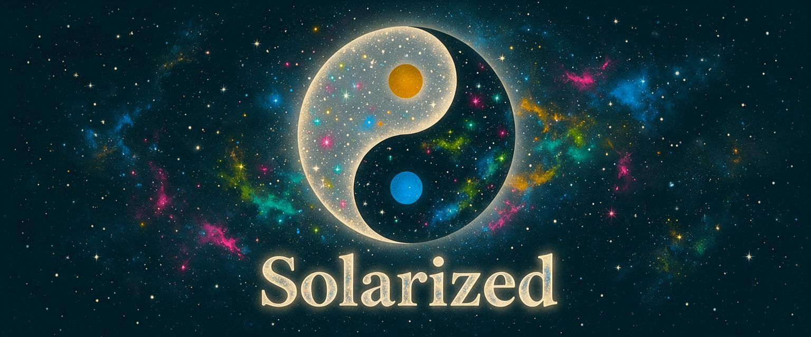
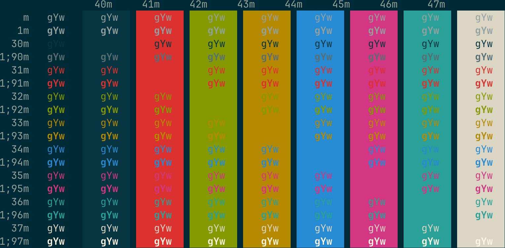

# Solarized | Ghostty
My own custom made Solarized (Dark) color scheme for Ghostty.

 

* [Ghostty for macOS and Linux](https://ghostty.org/)

* [Horizon for VS Code](https://horizontheme.netlify.app/) 

 

Place file in ~/.config/ghostty/themes/ (create folders if non-existing).

*Solarized*

